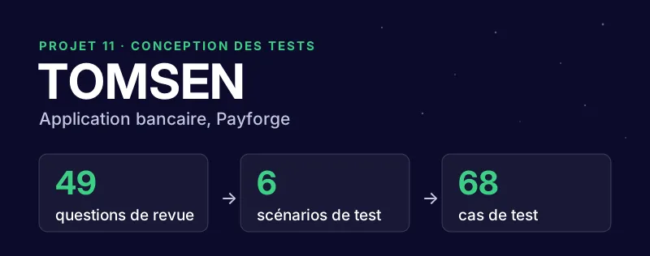

# TOMSEN : conception des tests d'une application bancaire

Projet réalisé dans le cadre de la formation **Développeur / testeur logiciel** d'OpenClassrooms (projet 11).

## Contexte

TOMSEN est une application bancaire en cours de conception chez Payforge, une entreprise fictive. Elle permet de créer un compte avec ses justificatifs, de se connecter avec une double authentification ou la biométrie, de consulter ses comptes de plusieurs banques sur un tableau de bord, de télécharger ses relevés, de suivre ses dépenses par catégorie et d'échanger avec un conseiller virtuel.

L'application n'était **pas encore développée**. Mon rôle de testeur était de préparer toute la campagne de test à partir des spécifications fonctionnelles (exigences TOM-6 à TOM-15), pour qu'elle soit prête dès les premiers sprints de développement.

## Ma démarche

Les trois livrables s'enchaînent : chacun s'appuie sur le précédent.

| Étape | Livrable | Ce que j'ai fait |
| --- | --- | --- |
| 1 | Revue d'exigences | Analyse des spécifications pour détecter les contradictions, les manques et les risques avant le développement. **49 questions**, dont 36 critiques, chacune avec une proposition de correction. |
| 2 | Stratégie de test | Définition de **6 scénarios** de test, des hypothèses de travail tirées de la revue, des méthodes de test (fonctionnelles, exploratoires, non-régression, automatisation sous conditions), des ressources, des données de test, de l'environnement et du planning par sprint. |
| 3 | Cahier de recette | Rédaction de **68 cas de test** détaillés pas à pas, avec une matrice de traçabilité entre exigences et cas de test, un jeu de données et un découpage par sprint. |

## Extraits

### Revue d'exigences : deux exemples de questions

| N° | Exigence | Constat | Criticité |
| --- | --- | --- | --- |
| 4 | TOM-8 | L'appel d'authentification transmet les identifiants dans l'URL (requête GET), ce qui expose le mot de passe. Proposition : passer en POST, identifiants dans le corps de la requête. | Critique |
| 2 | TOM-10 / TOM-11 | Les appels à la Banque de France sont limités à un toutes les 5 minutes, mais le bouton « Rafraîchir » n'encadre pas les clics répétés. Proposition : désactiver le bouton pendant 5 minutes en affichant le délai restant. | Critique |

### Cahier de recette : trois exemples de cas de test

| Cas de test | Ce qu'il vérifie |
| --- | --- |
| CDT-9 | Une personne âgée de 18 ans moins un jour ne peut pas créer de compte (test de valeur limite). |
| CDT-40 | Le bouton « Rafraîchir » reste désactivé pendant 5 minutes après un appel, avec une horloge de test pour contrôler les bornes (4 min 50 s, puis 5 min 10 s). |
| CDT-46 | En base de données, seuls les quatre derniers chiffres des numéros de compte sont enregistrés. |

## Compétences mobilisées

- Analyse et revue de spécifications fonctionnelles
- Conception d'une stratégie de test et choix des méthodes adaptées
- Rédaction de cas de test : valeurs limites, cas d'erreur, sécurité des données
- Traçabilité entre exigences et cas de test
- Préparation des données et de l'environnement de test

## Livrables

| Livrable | Fichier |
| --- | --- |
| Revue d'exigences | [1-revue-exigences.xlsx](livrables/1-revue-exigences.xlsx) |
| Stratégie de test | [2-strategie-de-test.pdf](livrables/2-strategie-de-test.pdf) |
| Cahier de recette | [3-cahier-de-recette.xlsx](livrables/3-cahier-de-recette.xlsx) |

Les données personnelles et bancaires présentes dans les livrables sont fictives.

## Auteur

**Aurélien Girodet**, testeur logiciel junior. [Voir mon portfolio](https://p12-testeurlogiciel-portfolio.pages.dev/)
